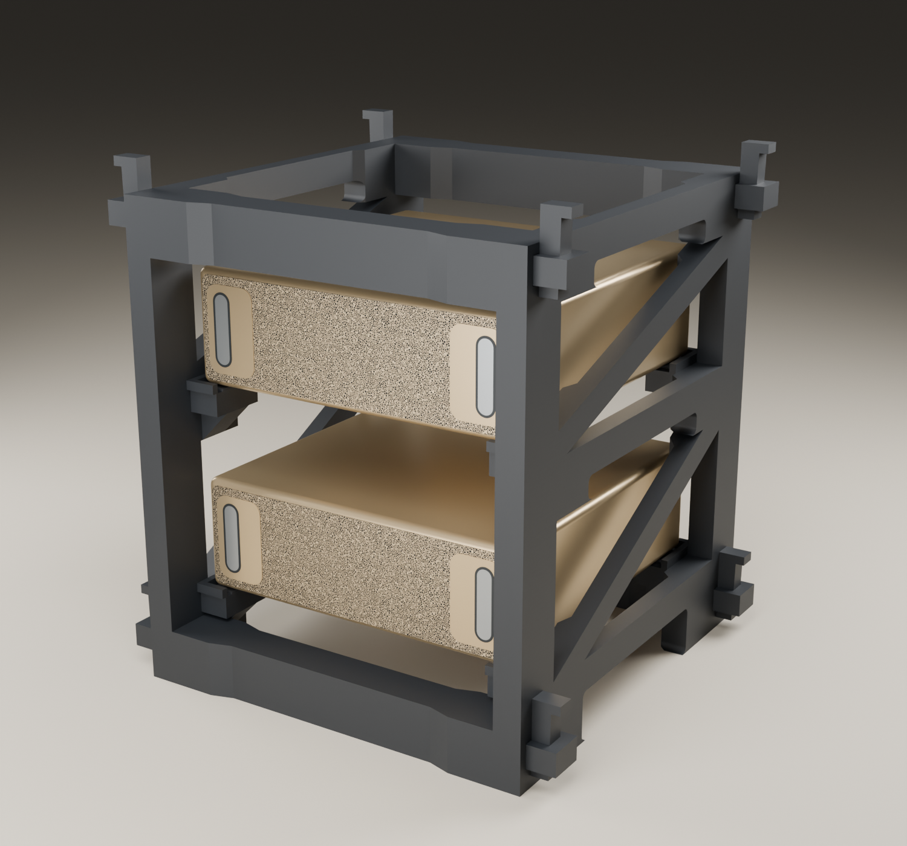
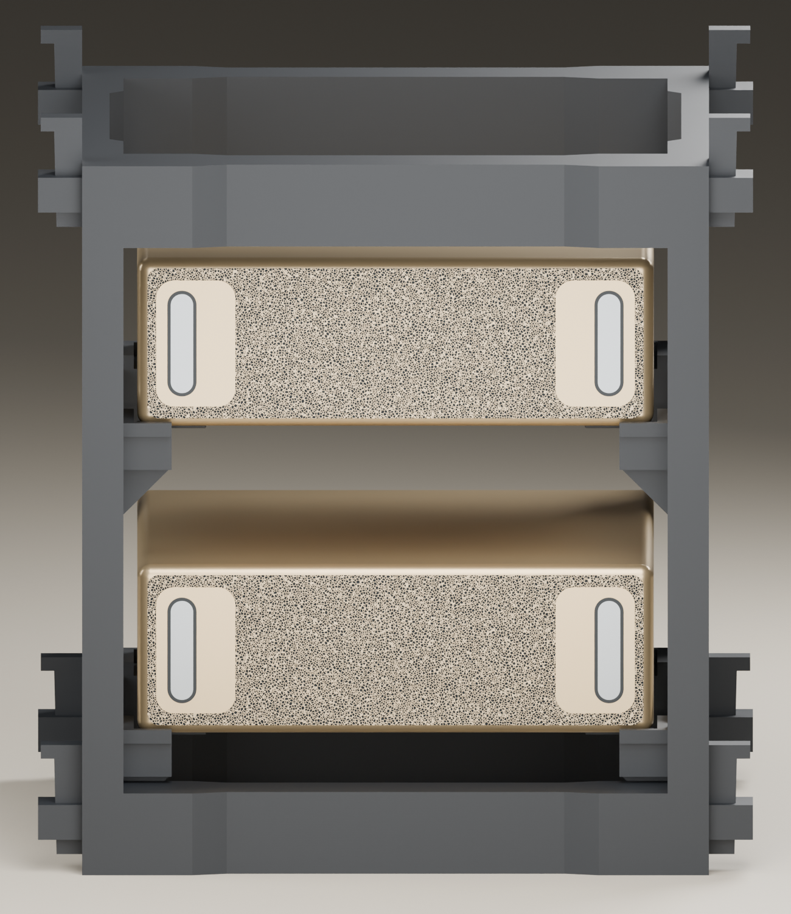

# Spark Stand Dual

ขาตั้ง DGX Spark แบบสองชั้น รุ่น Dual ชุดนี้ไม่ใช่ Modular และไม่ได้ออกแบบให้ต่อเพิ่มชั้น

ภาพเรนเดอร์แสดงการจัดวางสองชั้น ใช้คานทึบ v04 ส่วนไฟล์พิมพ์ที่แจกใช้คานโปร่ง v05 LIGHTER พร้อมโลโก้หนึ่งชิ้น เครื่องในภาพเป็นโมเดลจำลองที่โปรเจกต์สร้างขึ้น

ดูภาพด้านหน้า

ดาวน์โหลด [ชุดไฟล์ล่าสุด](https://github.com/apipoj/spark-stand-dual/releases/tag/v0.1.0) หรือเปิดไฟล์จาก [projects/](projects/) ได้เลย ไม่ต้องใช้ Python, CadQuery หรือ Blender

อนุญาตให้พิมพ์ใช้ส่วนตัวเท่านั้น ห้ามแก้แบบ แจกต่อไฟล์ ขายไฟล์หรือชิ้นงาน และใช้เชิงพาณิชย์ แชร์ลิงก์ repository แทนการส่งไฟล์ อ่าน [เงื่อนไขฉบับเต็ม](LICENSE.md) ก่อนดาวน์โหลด ต้องการซื้อสินค้าสำเร็จรูปใช้ [spark-stand.com](https://spark-stand.com)

## ไฟล์และค่าพิมพ์

| Plate | ชิ้นส่วน | ไฟล์ | ค่าที่บันทึก |
|---|---|---|---|
| 01 | แผงขวา ×1 | [right](projects/X2D_PLA_v04_LIGHT_plate_01_right.3mf) | 6 walls / 40% gyroid |
| 02 | แผงซ้าย ×1 | [left](projects/X2D_PLA_v04_LIGHT_plate_02_left.3mf) | 6 walls / 40% gyroid |
| 03 | คานโปร่ง ×4 มีโลโก้หนึ่งชิ้น | [crossbars](projects/X2D_PLA_v05_LIGHTER_plate_03_crossbars_x4.3mf) | 6 walls / 25% gyroid |
| 04 | ลิ่ม ×8 | [wedges](projects/X2D_PLA_v04_LIGHT_plate_04_pins_x8.3mf) | 6 walls / 40% gyroid |

โปรไฟล์ที่บันทึกคือ Bambu Lab X2D หัว 0.4 mm, Bambu PLA Basic, layer 0.20 mm และ Textured PEI Plate หน่วยรูปทรงเป็น mm

ชุดนี้ใช้แผงและลิ่ม Dual v04 ร่วมกับคานโปร่ง v05 LIGHTER ไม่ใช่การเปลี่ยนทั้งโครงเป็น v05 เปลี่ยนชื่อไฟล์จาก ASA เป็น PLA ให้ตรงโปรไฟล์ที่ฝังอยู่ เนื้อหา 3MF คงเดิมทุกไบต์

## เริ่มพิมพ์

1. ใน Bambu Studio ใช้ File → Open เปิด 3MF เป็น project เพื่อโหลดการจัดวางและค่าพิมพ์
2. ตรวจเครื่อง หัวฉีด แผ่นพิมพ์และเส้นให้ตรงอุปกรณ์จริง เปลี่ยนโปรไฟล์เมื่อใช้เครื่องหรือเส้นอื่น การเลือกช่อง AMS อย่างเดียวไม่เปลี่ยนโปรไฟล์ที่ใช้ Slice
3. Slice ใหม่และตรวจ Preview, support/brim, พื้นที่พิมพ์และ warning ทุกเพลตก่อนส่งพิมพ์
4. ทำครบทั้งสี่ไฟล์ แล้วทำตาม [คู่มือประกอบ](ASSEMBLY_TH.md)

ไฟล์ไม่มี G-code งานพิมพ์สำเร็จ แต่มีคำสั่งเริ่มและจบเครื่องในโปรไฟล์ ต้อง Slice ใหม่ด้วยโปรไฟล์ที่ตรงกับเครื่องของคุณ

## สถานะต้นแบบ

มีหลักฐานโครงพิมพ์และประกอบจริง รวมถึงวาง DGX Spark หนึ่งตัวบนชั้นล่าง น้ำหนักตัวแท่นที่ชั่งได้ 591.1 กรัมไม่ใช่พิกัดรับน้ำหนัก ยังไม่มีผลทดสอบรับน้ำหนักเต็มโครง ความร้อน การคืบหรืออายุใช้งานครบ โดยเฉพาะ PLA ไม่ได้รับการยืนยันสำหรับรองอุปกรณ์ต่อเนื่อง

ตรวจ geometry ครบ 14 ชิ้นเทียบกับ Dual STL แล้ว และมีผล Slice ผ่าน CLI ของ Bambu Studio 2.8.2.61 จากรอบเตรียมเผยแพร่ ยังไม่ได้ยืนยันเปิดและ Preview ผ่าน GUI ครบทั้งชุด ดู [ผลตรวจและข้อจำกัด](VERIFICATION.md)

Repository นี้มีไฟล์พิมพ์ Dual เอกสาร และภาพประกอบ ไม่มี CAD source หรือไฟล์ Modular
